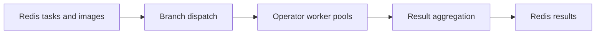

<!-- SPDX-License-Identifier: Apache-2.0 -->

# StreamForge

**English** | [简体中文](README.zh-CN.md)

StreamForge is a Python framework for building image-processing services. It runs configurable operator chains in worker processes, coordinates parallel branches, and returns structured results through a Redis-backed task workflow.

Applications supply the processing algorithms. StreamForge manages task validation, queues, worker lifecycles, result aggregation, and service controls. The core SDK can also be embedded in Python applications or used for JSONL processing without Redis.

## Features

- **Typed contracts:** strict Pydantic models for images, tasks, operator parameters, findings, and results.
- **Multiprocess execution:** shared worker infrastructure with bounded queues and backpressure.
- **Composable operators:** ordered operator chains, per-worker resource hooks, and explicit plugin registration.
- **Parallel branches:** configurable worker counts, task-level branch selection, and deterministic result aggregation.
- **Redis integration:** image-key lookup, acknowledged task claims, normal and health-result queues, and explicit recovery.
- **Service controls:** HTTP endpoints for start/stop, health, version, and validated configuration updates.

## How it works



A producer stores image bytes and submits a task containing the image key. The service validates the task, loads the image, and dispatches it to the selected branches. Each branch runs its operators in order. Once all selected branches finish, the service combines their outcomes and publishes one task result.

| Concept | Purpose |
| --- | --- |
| Operator | A processing step that accepts and returns a typed payload. |
| Operator chain | A sequence of operators executed by `CVOProcessor` inside a worker. |
| Branch | An independently configured processing path with its own worker pool. |
| Finding | A plugin-produced observation with a label, confidence, and optional geometry or measurements. |
| Result | The task's success/failure status, payload or error, and branch summary. |

See the [architecture diagrams](docs/architecture.md) for process boundaries and execution sequences.

## Getting started

Requires **Python 3.11+**. Run the commands below from the repository root in a Python virtual environment.

### Run the core example

```sh
python -m pip install -e .
python examples/image_pipeline.py
```

The example sends six synthetic PNG tasks through two worker processes, adds metadata tags, and prints their results. It runs without Redis or an HTTP server.

### Run the Redis service

Requires **Redis 6.2+** and the service dependencies:

```sh
python -m pip install -e ".[api,redis]"
```

Copy `examples/redis.json` to `redis.local.json` and set the Redis connection. The sample uses input database `0`, output database `1`, and a single branch with the built-in metadata tag operator. Start Redis at the configured address, then start the service:

```sh
python main.py --config redis.local.json
```

In a second terminal, send a sample image and wait for its result:

```sh
python simulate_client.py --config redis.local.json
```

The client saves the returned image and result JSON under `outputs/`. Add `--image path/to/image.png` to process a local file. With the sample configuration, a successful result includes the `processed` tag and preserves the input image bytes.

The control API is available at [localhost:8001/docs](http://127.0.0.1:8001/docs). Configuration changes use a stop → update → start sequence. Connection settings, message schemas, recovery, and the browser demo are covered in the [Redis guide](docs/redis-workflow.md).

### Other entry points

| Interface | Command |
| --- | --- |
| JSONL file processing | `python -m streamforge run --input examples/images.jsonl --output results.jsonl` |
| In-memory HTTP task API | `python -m streamforge serve --workers 2` |
| Redis browser demo | `python examples/redis_demo.py --config redis.local.json` |
| Redis terminal roundtrip | `python examples/redis_roundtrip.py --config redis.local.json` |

The JSONL output file must not already exist. The HTTP task API needs `.[api]`; Redis examples need `.[redis]`, and the browser demo also needs `.[api]`. Run each server example separately. The in-memory API and browser demo use port `8000` by default.

## Writing an operator

Define a parameter model and implement `process`. The processing base supplies configuration and output validation:

```python
from streamforge import BaseProcessor, ImagePayload, StrictModel


class LabelParameters(StrictModel):
    label: str


class LabelOperator(BaseProcessor[ImagePayload, LabelParameters]):
    parameters_model = LabelParameters

    def process(self, payload: ImagePayload) -> ImagePayload:
        return payload.model_copy(update={"tags": [*payload.tags, self.parameters.label]})
```

Register the operator by name in an application entry point, then reference it in a branch configuration. Operators can also be ordinary classes implementing the same parameter and processing contract. Optional `setup` and `teardown` hooks manage worker-local resources.

The [extension guide](docs/extension-guide.md) covers registration, custom stages, private intermediate data, and returning typed findings. Keep processor and operator classes at module scope, and place application execution behind `if __name__ == "__main__"` so workers can start with `spawn`.

## Runtime behavior

- Processing runs on one host. Branches can run concurrently, and each worker executes one task's operators in order.
- Queue capacity and pending-result limits bound admission. Slow consumers apply backpressure.
- Images are opaque encoded bytes, up to **16 MiB** per image. Operators own decoding and analysis. No inference models or detection algorithms are bundled.
- Failed branches produce structured outcomes. A task succeeds only when every selected branch succeeds. Empty findings alone are not a quality decision.
- Redis delivery is **at least once**. Cross-database interruption can lead to duplicate results, so consumers and side-effecting operators must tolerate replay.
- Shutdown drains accepted work within a configured budget. If claims remain in the processing list, stop the service owner and run the explicit recovery command before restarting. See [recovery semantics](docs/redis-workflow.md#delivery-and-recovery).

## Documentation

- [Architecture and sequence diagrams](docs/architecture.md)
- [Task workflow and component responsibilities](docs/workflow.md)
- [Redis configuration, messages, and recovery](docs/redis-workflow.md)
- [Stage and operator extensions](docs/extension-guide.md)
- [Development, IDE debugging, and releases](docs/development.md)
- [Verification record](docs/verification.md)

## Development

```sh
python -m pip install -e ".[api,redis,dev]"
python -m ruff check .
python -m ruff format --check .
python -m pytest -q
```

Redis integration tests require an isolated test server; setup is described in the [development guide](docs/development.md#local-checks). Without it, server-dependent tests are skipped.

For contributions and issue reports, see [CONTRIBUTING.md](CONTRIBUTING.md), [CODE_OF_CONDUCT.md](CODE_OF_CONDUCT.md), and [SECURITY.md](SECURITY.md).

## License

[Apache License 2.0](LICENSE). Attribution notices are in [NOTICE](NOTICE).
