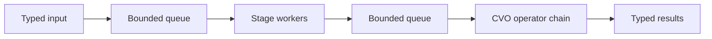

<!-- SPDX-License-Identifier: Apache-2.0 -->

# StreamForge

**English** | [简体中文](README.zh-CN.md)

A Python inspection and streaming framework with strict Pydantic v2 contracts, a shared processing base, configurable CVO branches, and an operational Redis-to-Redis workflow.

The workflow covers task ingestion, image lookup, dispatch, processing, result formatting/aggregation, publication, and runtime controls. The framework transports opaque image bytes and typed findings. Detection algorithms are supplied through plugins; model weights and inference implementations are not bundled.

See the [architecture and sequence diagrams](docs/architecture.md) for the system overview, process boundaries, task processing, lifecycle controls and recovery.

## Quick start

Requires Python 3.11 or newer. From the repository root in PowerShell:

```powershell
python -m venv .venv
.\.venv\Scripts\python.exe -m pip install -e '.[api,redis,dev]'
.\.venv\Scripts\python.exe examples/image_pipeline.py
.\.venv\Scripts\python.exe -m pytest -q
```

For just the core SDK and JSONL interface, use `pip install -e .`. Pydantic is the core's only direct runtime dependency.

## Direct IDE startup and independent image client

Debug the root `main.py` directly to start the Redis service, workers and HTTP controls on port 8001. In a separate IDE run configuration or terminal, run `simulate_client.py` to send one image, wait for its result, and save the returned image and full result JSON under the ignored `outputs/` directory.

```powershell
python main.py
# Run separately after the service is ready.
python simulate_client.py
# Send your own image instead of the built-in synthetic PNG.
python simulate_client.py --image C:\images\sample.png
```

Both scripts use root `debug.local.json` when it exists, otherwise `examples/redis.json`; `--config PATH` overrides that choice. They require the configured Redis server to be running. The client uses the same configured queues and does not start workers. Enable subprocess debugging to hit operator breakpoints. See the [IDE debugging guide](docs/development.md#ide-debugging) for details.

Service logs use `[timestamp][module][line][level]: message`. Each image produces a `↓ redis =>` receipt and an `↑ redis =>` publication line at INFO level, with task identifiers and elapsed time; intermediate processing details are DEBUG. A plain copy is written to `logs/streamforge.log` beside the selected configuration and rotated daily.

## Redis inspection system

With Redis >=6.2 running at the configured address:

```powershell
python examples/redis_demo.py --config examples/redis.json
python examples/redis_roundtrip.py --config examples/redis.json
python -m streamforge redis --config examples/redis.json
python -m streamforge redis-serve --config examples/redis.json
```

The browser demo runs at [localhost:8000](http://127.0.0.1:8000), with a send-batch button, live counters, worker identifiers and actual Redis results. The roundtrip command demonstrates the same workflow in a terminal and cleans up its disposable keys. The other commands run the message-processing service and HTTP controls. See the [operational guide](docs/redis-workflow.md) and [workflow guide](docs/workflow.md).

```text
src/streamforge/
  models.py, processor.py, worker.py, pipeline.py, operators.py
  messages.py         Task/image-reference/result message contracts
  application/
    models.py         Service settings, runtime status and run reports
    configuration.py  Concrete plugin configuration and OpenAPI schemas
    service.py        TaskService: end-to-end orchestration and backpressure
    controller.py     ServiceController: start/stop and configuration persistence
    api.py            Optional HTTP system controls
  inspection/
    models.py         Typed findings, branch outcomes and inspection summaries
    workflow.py       Background dispatch and deterministic branch aggregation
  transports/redis/
    models.py         Redis connection, queue settings and recovery report
    transport.py      Recoverable claims, image lookup and acknowledged publication
```

Application code owns the processing lifecycle; the Redis adapter owns database I/O and imports the shared message contracts. Redis is the currently supported operational backend. Configuration JSON defines connection settings, queues and processing branches. See the [package layout](docs/development.md#package-layout) for application and transport imports.

Processing branches are configured as ordered operator chains. A submitted inspection starts processing without requiring a result consumer. The default registry contains metadata handling only; an empty finding list is not a quality verdict. A separate generic input/output adapter is also available below.

```powershell
# Process each input line immediately, preserving image bytes.
Get-Content -LiteralPath examples/images.jsonl | python -m streamforge run

# Append generic metadata. The output file must not already exist.
python -m streamforge run --input examples/images.jsonl --output results.jsonl --tag received

# Start the optional HTTP adapter with two CVO workers.
python -m streamforge serve --workers 2
```

HTTP documentation: [Swagger UI](http://127.0.0.1:8000/docs). `GET /health` reports status; `POST /tasks` submits a task and waits for its result.

## Contracts

```json
{
  "task_id": "frame-001",
  "payload": {
    "image": {"media_type": "image/png", "content_base64": "aW1hZ2U="},
    "tags": []
  }
}
```

Omit `task_id` to generate one. Identifiers contain 1–128 ASCII letters, digits, underscores, dots, or hyphens. The Base64 above illustrates transport; `examples/images.jsonl` contains a runnable PNG task. Images are opaque bytes, limited to 16 MiB each. The framework validates Base64 encoding, not whether bytes match the declared format.

Success returns `status="succeeded"`, a typed `payload`, and a null `error`. Failure returns `status="failed"`, a null `payload`, and an error with `stage`, `error_type`, and `message`. Unknown fields and implicit numeric coercion are rejected. JSON is a transport format; the SDK accepts model instances.

## SDK

```python
from streamforge import ImageData, ImagePayload, PipelineConfig, Task
from streamforge.image import image_pipeline


def main():
    with image_pipeline(
        config=PipelineConfig(queue_capacity=8, max_pending=16),
        workers=2,
    ) as pipeline:
        image = ImageData.from_bytes(b"opaque-image-bytes", media_type="image/png")
        task = Task[ImagePayload](payload=ImagePayload(image=image))
        pipeline.submit(task, timeout=1.0)
        result = pipeline.result(task.task_id, timeout=10.0)
        print(result.status)


if __name__ == "__main__":
    main()
```

Windows uses `spawn`. Put application execution behind `if __name__ == "__main__"` and define processors, parameters, and operators at importable module scope. Imports do not start workers.

The core supports any concrete `StrictModel` payload. All stages in a pipeline use the same payload schema; declare new fields explicitly in your own model.

## Stages and CVO

Inherit `BaseProcessor[Payload, Parameters]`, declare `parameters_model`, and implement `process`. Optional `setup/teardown` hooks own process-local resources. The framework supplies one queue loop, validation, and error handling.

CVO is available by default. An empty chain passes images through; configured operators execute in order. Operators declare a strict parameter model and `process(payload)`. They may be ordinary classes or use the convenience base. The scheduler does not inspect their private data or load layers, templates, or engineering files. See the [extension guide](docs/extension-guide.md).



## Concurrency and lifecycle

- `submit` queues a task; `result(task_id)` retrieves a specific result; `receive()` retrieves the next completed result. Retrieval consumes the result and releases capacity.
- `max_pending` bounds processing tasks and completed, unclaimed results. Stage queues have separate capacity limits.
- Submission timeouts bound capacity and queue-admission waits; validation and serialization happen before that admission deadline. The Redis service also enforces a separate task processing timeout.
- `map(tasks)` prefetches a bounded window and yields in input order. It requires exclusive pipeline use and an iterator that supplies input promptly. For sparse live input, use `submit/result` or concurrent `submit/receive`.
- JSONL processes one line at a time for immediate output. Use SDK `map` or concurrent HTTP requests for multiple frames in flight.
- A task failure skips downstream stages while later tasks continue. There are no automatic retries or implied exactly-once side effects.
- Initialization failure or unexpected worker exit fails the pipeline and provides errors for unfinished tasks.
- `discard(task_id)` abandons a result and releases capacity without interrupting a running operator. Internal dispatch identifiers isolate late results from reused task identifiers.
- `close()` drains stages and returns `ShutdownReport`, including any pipeline-level error. On timeout it terminates remaining workers and fails unfinished tasks. Context managers call it automatically; call again to inspect the same report. Cleanup exceptions and abnormal worker exits are reported as non-graceful shutdowns.

HTTP uses 422 for validation, 409 for duplicate pending identifiers, 429 for capacity exhaustion, 504 for result timeout, and 503 for unavailable pipelines. Processing failures use HTTP 200 with a typed failure result. Timed-out requests discard results to release capacity. One application lifespan owns one pipeline.

## Scope

Core Pipeline supplies sequential stages; InspectionWorkflow adds configurable fan-out/fan-in, and the Redis service supplies an operational source-to-sink chain with recoverable claims. It remains a single-host processing system and does not include general DAG execution, distributed coordination, Kafka connectors, cross-server transactions or shared-memory images. Changes to active worker configuration require stopping and rebuilding. Redis recovery is at least once, not exactly once. Serialization copies data and Base64 adds overhead; size capacities for the workload. Operators have no hard real-time guarantee.

## Community

Licensed under [Apache-2.0](LICENSE), with attribution in [NOTICE](NOTICE). See [CONTRIBUTING.md](CONTRIBUTING.md), [CODE_OF_CONDUCT.md](CODE_OF_CONDUCT.md), [SECURITY.md](SECURITY.md), and [CHANGELOG.md](CHANGELOG.md).

The [development guide](docs/development.md) covers checks and releases. The [provenance record](docs/provenance.md) describes source and dependency boundaries. [Verification results](docs/verification.md) distinguish local checks from hosted CI that has not run yet.
