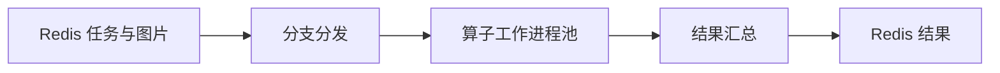

<!-- SPDX-License-Identifier: Apache-2.0 -->

# StreamForge

[English](README.md) | **简体中文**

StreamForge 是一个用于构建图像处理服务的 Python 框架。它在工作进程中运行可配置的算子链，协调并行分支，并通过 Redis 任务工作流返回结构化结果。

应用提供具体的处理算法，StreamForge 负责任务校验、队列、工作进程生命周期、结果汇总和服务控制。核心 SDK 也可以脱离 Redis，直接集成到 Python 应用或处理 JSONL 数据。

## 核心能力

- **明确的数据契约**：图片、任务、算子参数、检测发现和结果均使用严格的 Pydantic 模型。
- **多进程执行**：复用统一工作进程机制，通过有界队列和背压限制任务提交。
- **可组合的算子**：支持顺序算子链、进程内资源钩子和显式插件注册。
- **并行分支**：可配置各分支的工作进程数，按任务选择分支，并以固定顺序汇总结果。
- **Redis 集成**：支持按 Key 取图、带确认的任务认领、正常／健康结果队列和显式恢复。
- **服务控制**：通过 HTTP 接口管理启停、健康状态、版本和经过校验的配置更新。

## 工作方式



生产者先保存图片字节，再提交包含图片 Key 的任务。服务校验任务、读取图片，并将任务分发到指定分支。各分支按顺序执行自己的算子；所选分支全部完成后，服务合并分支状态和数据，发布一份任务结果。

| 概念 | 作用 |
| --- | --- |
| 算子 | 接收并返回类型化负载的一个处理步骤。 |
| 算子链 | 由工作进程中的 `CVOProcessor` 顺序执行的一组算子。 |
| 分支 | 独立配置的处理路径，拥有自己的工作进程池。 |
| 检测发现 | 插件产生的观察结果，包含标签、置信度及可选的几何信息或测量项。 |
| 任务结果 | 任务的成功／失败状态、负载或错误，以及各分支的汇总信息。 |

进程边界和执行顺序见[架构图与时序图](docs/architecture.md)。

## 快速开始

需要 **Python 3.11 或更新版本**。请在 Python 虚拟环境中，从仓库根目录执行以下命令。

### 运行核心示例

```sh
python -m pip install -e .
python examples/image_pipeline.py
```

该示例通过两个工作进程处理六个合成 PNG 任务，添加元数据标签并输出结果，无须启动 Redis 或 HTTP 服务。

### 运行 Redis 服务

需要 **Redis 6.2 或更新版本**，并安装服务依赖：

```sh
python -m pip install -e ".[api,redis]"
```

将 `examples/redis.json` 复制为 `redis.local.json`，修改其中的 Redis 连接参数。示例使用输入数据库 `0`、输出数据库 `1`，并配置一个包含内置标签算子的分支。在配置的地址启动 Redis 后，启动任务服务：

```sh
python main.py --config redis.local.json
```

在第二个终端发送一张示例图片，并等待返回结果：

```sh
python simulate_client.py --config redis.local.json
```

客户端将返回的图片和结果 JSON 保存到 `outputs/`。添加 `--image path/to/image.png` 可以发送本地图片。使用示例配置时，成功结果会包含 `processed` 标签，并保留输入图片的字节。

控制接口文档位于 [localhost:8001/docs](http://127.0.0.1:8001/docs)。更新配置采用“停止 → 更新 → 启动”的顺序。连接设置、消息结构、任务恢复及浏览器演示见 [Redis 运行指南](docs/redis-workflow.md)。

### 其他运行入口

| 接口 | 命令 |
| --- | --- |
| JSONL 文件处理 | `python -m streamforge run --input examples/images.jsonl --output results.jsonl` |
| 内存 HTTP 任务接口 | `python -m streamforge serve --workers 2` |
| Redis 浏览器演示 | `python examples/redis_demo.py --config redis.local.json` |
| Redis 终端全链路演示 | `python examples/redis_roundtrip.py --config redis.local.json` |

JSONL 输出文件需要使用尚不存在的路径。HTTP 任务接口需要安装 `.[api]`；Redis 示例需要 `.[redis]`，浏览器演示还需要 `.[api]`。各服务示例应分别运行；内存 HTTP 接口和浏览器演示默认都使用 `8000` 端口。

## 编写算子

定义参数模型并实现 `process`，处理器基类负责配置和输出校验：

```python
from streamforge import BaseProcessor, ImagePayload, StrictModel


class LabelParameters(StrictModel):
    label: str


class LabelOperator(BaseProcessor[ImagePayload, LabelParameters]):
    parameters_model = LabelParameters

    def process(self, payload: ImagePayload) -> ImagePayload:
        return payload.model_copy(update={"tags": [*payload.tags, self.parameters.label]})
```

在应用入口按名称注册算子，然后在分支配置中引用它。算子也可以采用普通类，只要满足相同的参数与处理契约即可。可选的 `setup` 和 `teardown` 钩子用于管理工作进程内部的资源。

注册、自定义处理阶段、私有中间数据及类型化检测结果的用法见[扩展指南](docs/extension-guide.md)。处理器和算子类需要定义在模块顶层；应用执行代码应放在 `if __name__ == "__main__"` 保护中，以便工作进程通过 `spawn` 启动。

## 运行机制与边界

- 处理运行在单台主机上。不同分支可以并发执行，各工作进程按顺序执行单个任务的算子链。
- 队列容量和待领取结果数量共同限制任务提交；消费者较慢时会形成背压。
- 图片按不透明的编码字节传递，每张图片最大 **16 MiB**。解码和分析由算子负责，框架不内置推理模型或检测算法。
- 分支失败会产生结构化结果；仅当所有选中分支均成功时，任务才成功。检测发现列表为空本身不代表质量合格。
- Redis 采用“**至少一次**”投递语义。跨数据库发布过程中发生中断可能产生重复结果，消费者和有副作用的算子需要容忍重放。
- 关闭服务时，在配置的时间预算内排空已接收任务。如果处理中列表仍有认领记录，需要先停止其服务拥有者，执行显式恢复命令，再重新启动。详见[恢复语义](docs/redis-workflow.md#delivery-and-recovery)。

## 文档

- [架构图与时序图](docs/architecture.md)
- [任务工作流与模块职责](docs/workflow.md)
- [Redis 配置、消息与恢复](docs/redis-workflow.md)
- [处理阶段与算子扩展](docs/extension-guide.md)
- [开发、IDE 调试与发布](docs/development.md)
- [验证记录](docs/verification.md)

## 参与开发

```sh
python -m pip install -e ".[api,redis,dev]"
python -m ruff check .
python -m ruff format --check .
python -m pytest -q
```

Redis 集成测试需要独立的测试服务器，配置方法见[开发指南](docs/development.md#local-checks)。未提供测试服务器时，依赖服务器的测试会被跳过。

贡献代码或报告问题前，请阅读[贡献指南](CONTRIBUTING.md)、[行为准则](CODE_OF_CONDUCT.md)和[安全政策](SECURITY.md)。

## 许可证

[Apache License 2.0](LICENSE)，归属声明见 [NOTICE](NOTICE)。
