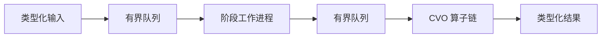

<!-- SPDX-License-Identifier: Apache-2.0 -->

# StreamForge

[English](README.md) | **简体中文**

一个 Python 检测与流式处理框架，提供严格的 Pydantic v2 数据契约、统一的处理器基类、可配置的 CVO 算子分支，以及完整的 Redis 输入到 Redis 输出工作流。

工作流包含任务获取、图片读取、分发、处理、结果格式化与汇总、结果推出和运行控制。框架传递不透明的图片字节和有明确类型的检测结果。检测算法通过插件提供，不内置模型权重或推理实现。

系统全貌、进程边界、任务处理顺序、生命周期控制和恢复流程见[架构图与时序图](docs/architecture.md)。

## 快速开始

需要 Python 3.11 或更新版本。在仓库根目录使用 PowerShell 执行：

```powershell
python -m venv .venv
.\.venv\Scripts\python.exe -m pip install -e '.[api,redis,dev]'
.\.venv\Scripts\python.exe examples/image_pipeline.py
.\.venv\Scripts\python.exe -m pytest -q
```

如果只使用核心 SDK 和 JSONL 接口，可以执行 `pip install -e .`。Pydantic 是核心框架唯一的直接运行依赖。

## 在 IDE 中直接启动与独立图像客户端

直接 Debug 仓库根目录的 `main.py`，即可启动 Redis 任务服务、工作进程和 HTTP 控制接口，默认端口为 8001。在另一个 IDE 运行配置或终端中启动 `simulate_client.py`：客户端发送一张图片，等待对应结果，然后将返回图片和完整结果 JSON 保存到被 Git 忽略的 `outputs/` 目录。

```powershell
python main.py
# Run separately after the service is ready.
python simulate_client.py
# Send your own image instead of the built-in synthetic PNG.
python simulate_client.py --image C:\images\sample.png
```

两个脚本优先使用根目录的 `debug.local.json`；该文件不存在时使用 `examples/redis.json`，也可以通过 `--config PATH` 指定配置。配置中的 Redis 服务需要事先启动。客户端使用相同的队列配置，不会自行启动工作进程。要命中算子中的断点，需要启用子进程调试。具体操作见 [IDE 调试指南](docs/development.md#ide-debugging)。

服务日志采用 `[timestamp][module][line][level]: message` 格式。每张图片在 INFO 级别输出一条 `↓ redis =>` 接收日志和一条 `↑ redis =>` 推出日志，包含任务标识和耗时；中间处理细节记录在 DEBUG 级别。无颜色的日志副本写入所选配置文件旁的 `logs/streamforge.log`，并按日轮转。

## Redis 检测系统

在配置的地址启动 Redis 6.2 或更新版本后，可使用以下入口：

```powershell
python examples/redis_demo.py --config examples/redis.json
python examples/redis_roundtrip.py --config examples/redis.json
python -m streamforge redis --config examples/redis.json
python -m streamforge redis-serve --config examples/redis.json
```

浏览器演示位于 [localhost:8000](http://127.0.0.1:8000)，提供批量发送按钮、实时计数器、工作进程标识和实际 Redis 结果。`redis_roundtrip.py` 在终端中演示同一工作流，结束后清理本次演示创建的临时 Key。其余命令分别运行任务处理服务和 HTTP 控制接口。详见[运行指南](docs/redis-workflow.md)和[工作流说明](docs/workflow.md)。

```text
src/streamforge/
  models.py, processor.py, worker.py, pipeline.py, operators.py
  messages.py         任务、图片引用和结果消息的数据契约
  application/
    models.py         服务配置、运行状态和运行报告
    configuration.py  具体插件参数配置与 OpenAPI Schema
    service.py        TaskService：完整任务编排与背压控制
    controller.py     ServiceController：启停与配置持久化
    api.py            可选的 HTTP 系统控制接口
  inspection/
    models.py         检测发现、分支结果和检测汇总的类型定义
    workflow.py       后台分发与按固定顺序执行的分支结果汇总
  transports/redis/
    models.py         Redis 连接、队列配置和恢复报告
    transport.py      可恢复的任务认领、图片读取与带确认的结果发布
```

应用层管理处理生命周期；Redis 适配器负责数据库 I/O，并使用共享消息模型。Redis 是当前支持的运行后端。配置 JSON 定义连接参数、队列和处理分支。应用层与传输层的导入位置见[包结构说明](docs/development.md#package-layout)。

处理分支可配置为按顺序执行的算子链。检测任务提交后会自行推进处理，无须等待消费者主动获取结果。默认注册表仅提供元数据处理；检测发现列表为空不代表质量合格。下方还提供了独立的通用输入输出入口。

```powershell
# Process each input line immediately, preserving image bytes.
Get-Content -LiteralPath examples/images.jsonl | python -m streamforge run

# Append generic metadata. The output file must not already exist.
python -m streamforge run --input examples/images.jsonl --output results.jsonl --tag received

# Start the optional HTTP adapter with two CVO workers.
python -m streamforge serve --workers 2
```

HTTP 接口文档：[Swagger UI](http://127.0.0.1:8000/docs)。`GET /health` 返回运行状态；`POST /tasks` 提交任务并等待结果。

## 数据契约

```json
{
  "task_id": "frame-001",
  "payload": {
    "image": {"media_type": "image/png", "content_base64": "aW1hZ2U="},
    "tags": []
  }
}
```

省略 `task_id` 时会自动生成标识。标识长度为 1～128 个字符，仅允许 ASCII 字母、数字、下划线、点和连字符。上方 Base64 仅用于说明传输格式；`examples/images.jsonl` 中提供了可运行的 PNG 任务。图片作为不透明字节传递，每张图片最大为 16 MiB。框架校验 Base64 编码，不检查图片字节是否符合声明的媒体格式。

成功结果包含 `status="succeeded"`、有明确类型的 `payload` 和空值 `error`。失败结果包含 `status="failed"`、空值 `payload`，以及带有 `stage`、`error_type` 和 `message` 的错误信息。未知字段和隐式数值类型转换会被拒绝。JSON 是传输格式；SDK 接收模型实例。

## SDK

```python
from streamforge import ImageData, ImagePayload, PipelineConfig, Task
from streamforge.image import image_pipeline


def main():
    with image_pipeline(
        config=PipelineConfig(queue_capacity=8, max_pending=16),
        workers=2,
    ) as pipeline:
        image = ImageData.from_bytes(b"opaque-image-bytes", media_type="image/png")
        task = Task[ImagePayload](payload=ImagePayload(image=image))
        pipeline.submit(task, timeout=1.0)
        result = pipeline.result(task.task_id, timeout=10.0)
        print(result.status)


if __name__ == "__main__":
    main()
```

Windows 使用 `spawn` 启动子进程。请将应用执行入口放在 `if __name__ == "__main__"` 保护中，并在可导入模块的顶层定义处理器、参数模型和算子。导入包不会启动工作进程。

核心框架支持任意具体的 `StrictModel` 负载。同一条流水线的所有阶段使用同一个负载 Schema；如需增加字段，请在自己的模型中明确声明。

## 处理阶段与 CVO

继承 `BaseProcessor[Payload, Parameters]`，声明 `parameters_model`，并实现 `process`。可选的 `setup/teardown` 钩子用于管理当前进程内的资源。框架统一提供队列循环、校验和错误处理。

CVO 默认可用。空算子链原样传递图片；配置的算子按顺序执行。算子需要声明严格的参数模型并提供 `process(payload)`，可以使用普通类，也可以继承便捷基类。调度器不检查算子私有数据，也不加载图层、模板或工程文件。详见[扩展指南](docs/extension-guide.md)。



## 并发与生命周期

- `submit` 提交任务；`result(task_id)` 获取指定任务结果；`receive()` 获取下一个已完成结果。获取操作会消费结果并释放容量。
- `max_pending` 限制处理中任务和已完成但尚未领取的结果总量。各阶段队列还有独立的容量限制。
- 提交超时限制容量等待和入队等待时间；校验与序列化发生在该入队等待预算开始之前。Redis 服务另外设置了独立的任务处理超时。
- `map(tasks)` 在有界窗口内预取任务，并按输入顺序返回结果。它要求独占流水线，且输入迭代器能够及时提供任务。对于稀疏实时输入，请使用 `submit/result` 或并发的 `submit/receive`。
- JSONL 接口逐行处理并立即输出结果。如需同时处理多张图片，可使用 SDK 的 `map` 或并发 HTTP 请求。
- 单个任务失败后会跳过后续处理阶段，其他任务仍继续处理。框架不提供自动重试，也不隐含“恰好一次”的副作用保证。
- 初始化失败或工作进程意外退出会使流水线失败，并为未完成任务提供错误结果。
- `discard(task_id)` 放弃结果并释放容量，不会中断已经运行的算子。内部调度标识可隔离任务标识复用后的迟到结果。
- `close()` 排空各处理阶段并返回 `ShutdownReport`，其中包含流水线级错误。超时后会终止剩余工作进程，并将未完成任务标记为失败。上下文管理器会自动调用它；再次调用可以查看同一份报告。资源清理异常和进程异常退出会被报告为非正常关闭。

HTTP 接口对校验错误返回 422，重复的在途任务标识返回 409，容量耗尽返回 429，等待结果超时返回 504，流水线不可用返回 503。处理过程中的任务失败使用 HTTP 200 返回有明确类型的失败结果。请求超时后会放弃对应结果以释放容量。每个应用生命周期独立管理一条流水线。

## 范围与边界

核心 `Pipeline` 提供顺序处理阶段；`InspectionWorkflow` 增加可配置的扇出／扇入分支；Redis 服务提供带可恢复认领的完整输入输出链路。系统仍以单台处理主机为边界，不包含通用 DAG 执行、分布式协调、Kafka 连接器、跨服务器事务或共享内存图片。修改活动工作进程的配置需要先停止再重建。Redis 恢复采用“至少一次”语义，不保证“恰好一次”。序列化会复制数据，Base64 也会增加体积，请根据实际负载设置容量。算子没有硬实时保证。

## 社区与协作

项目使用 [Apache-2.0](LICENSE) 许可证，归属声明见 [NOTICE](NOTICE)。另请参阅[贡献指南](CONTRIBUTING.md)、[行为准则](CODE_OF_CONDUCT.md)、[安全政策](SECURITY.md)和[变更记录](CHANGELOG.md)。

[开发指南](docs/development.md)说明检查与发布流程；[来源记录](docs/provenance.md)说明源码和依赖边界；[验证记录](docs/verification.md)区分了本地已执行的检查与尚未运行的托管 CI。
