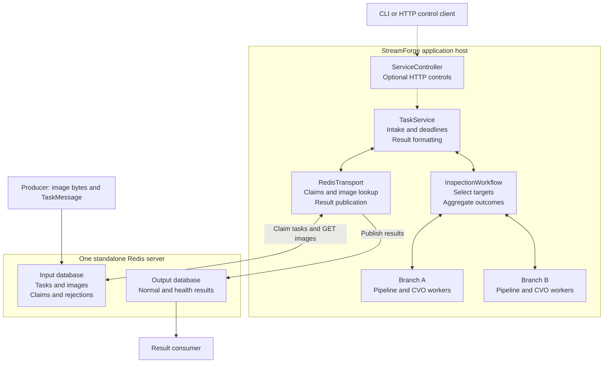
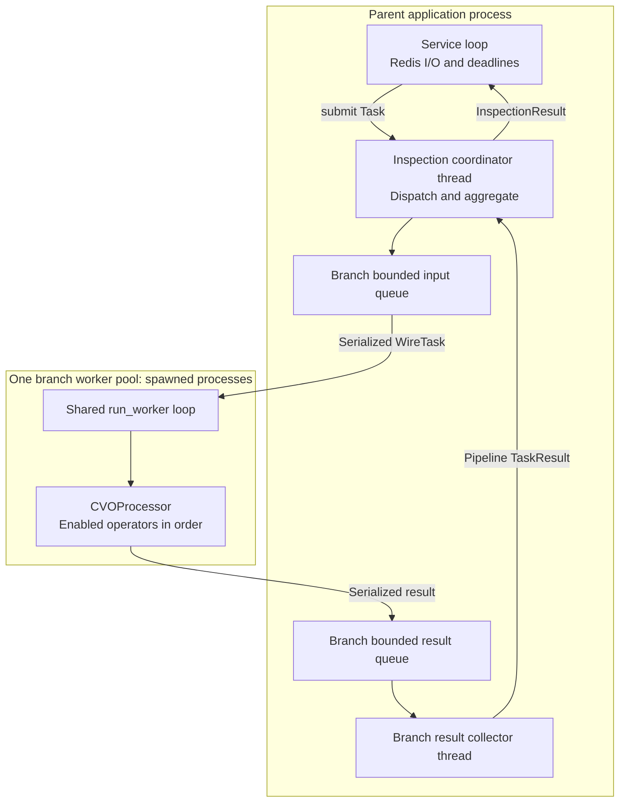
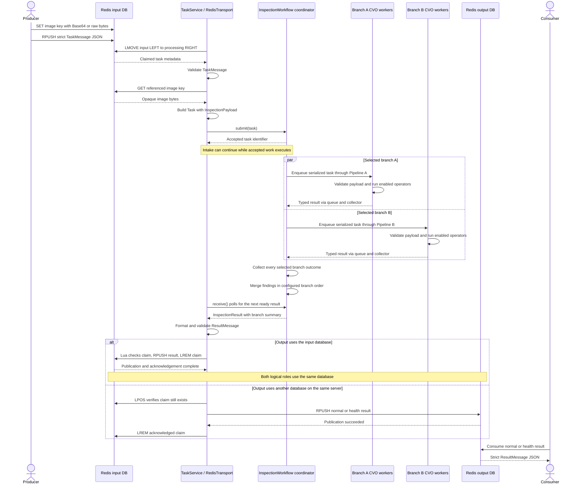
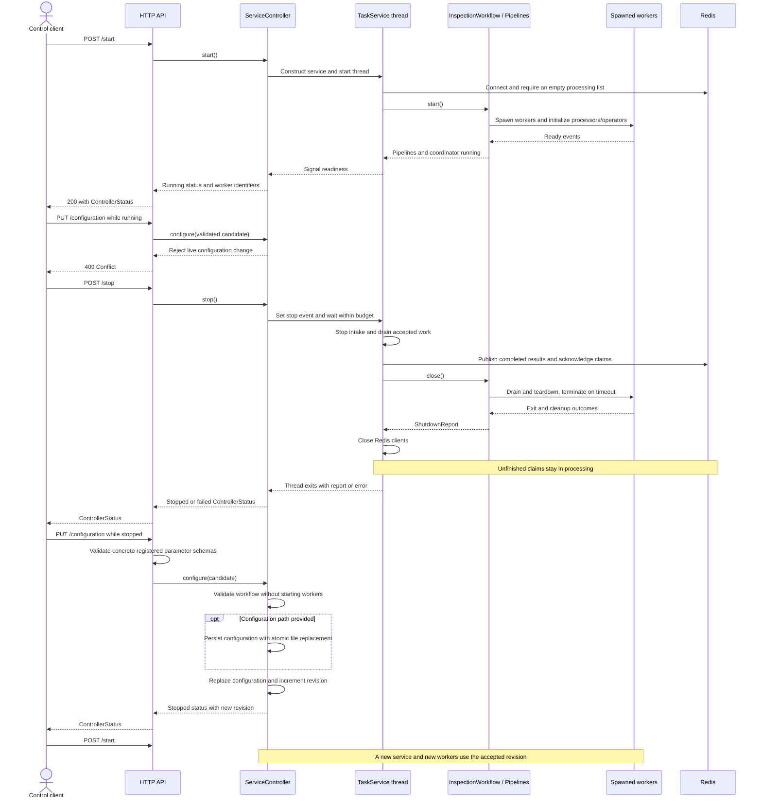
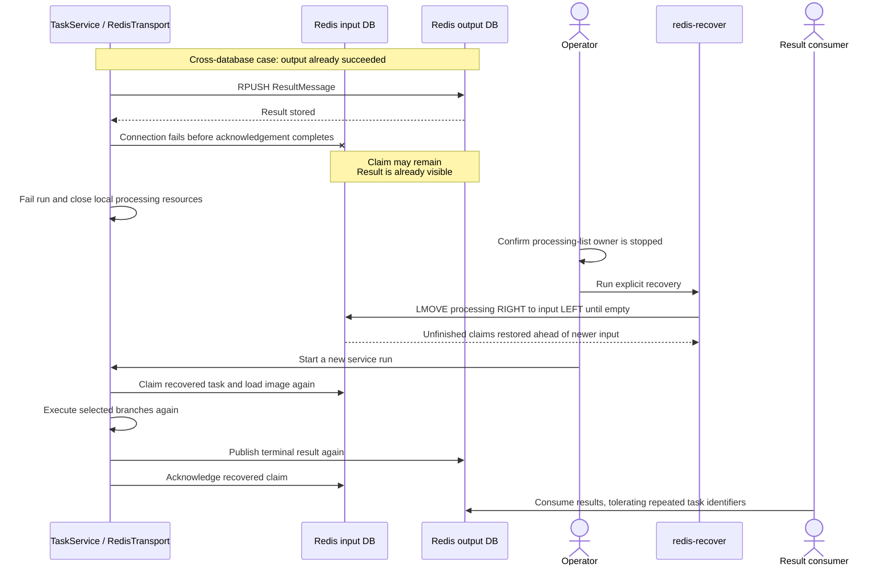

<!-- SPDX-License-Identifier: Apache-2.0 -->

# Architecture and sequence diagrams

These diagrams describe the implemented Redis inspection workflow. Start with the system overview, then the process boundaries and task sequence. The [operational guide](redis-workflow.md) provides run commands; the [workflow guide](workflow.md) maps processing responsibilities to their implementation modules.

Rendered SVG copies are available for viewers without Mermaid support. They are generated from the source blocks below using Mermaid CLI 12.0.0; the framework does not depend on a diagram renderer at runtime.

## System overview

[Open rendered system overview](diagrams/system-overview.svg).

Solid arrows show data exchange; dashed arrows show lifecycle control. Input and output are logical roles: `output_db` can select another database on the same server or reuse `connection.db`. Rejections stay in the input database. One branch is the default; additional branches are configuration, and task `targets` can select a subset.

HTTP mode uses `ServiceController` to run the service on a background thread. The `redis` CLI command runs `TaskService` directly without a controller or HTTP server. JSONL and the in-memory HTTP adapter are separate SDK entry points.

## Processes, threads and operator ownership

[Open rendered process boundaries](diagrams/process-boundaries.svg).

The diagram expands one representative branch. Each configured inspection branch owns a one-stage `Pipeline`, a collector thread, bounded queues and a configurable worker pool. Workers in the same pool share its input queue; one task is processed by one worker per selected branch. Branches can run concurrently. The coordinator admits branches incrementally when capacity is available, and continues working independently of result retrieval. It converts pipeline results into typed branch outcomes before aggregation.

Inside each worker, `BaseProcessor` supplies the common execution contract and `CVOProcessor` runs operators sequentially. Operators declare concrete parameter models and a `process` method; optional `setup` and `teardown` hooks own process-local resources. Private intermediate structures belong to operators. There is no framework layer-file loader, per-operator subprocess, or bundled detection algorithm.

The service and workflow bound pending tasks; each pipeline also bounds its queues and pending results. Serialization copies image data across process boundaries. Redis clients remain in the parent process.

## Task processing sequence

[Open rendered task sequence](diagrams/task-sequence.svg).

This sequence assumes the service has started. Pipeline queue handling and collector threads are summarized by the branch-worker participants.

Health tasks follow the same operator and aggregation path, then use `health_output`. An empty `targets` list selects all configured branches. The result retains the source-image reference and, on success, the original image bytes; branch-local image transformations are not merged. A branch failure makes the task fail while preserving available findings and all collected branch outcomes in the inspection summary.

The default registry contains only a metadata tag operator. Empty findings do not represent a quality verdict. See the [extension guide](extension-guide.md) for adding trusted external algorithms through strict models.

## Start, stop and configuration sequence

[Open rendered lifecycle sequence](diagrams/lifecycle-sequence.svg).

The CLI control server and browser demo normally autostart the controller during application lifespan. Repeated starts while running return the existing status. `/health` reports state and counters; `/version` reports the installed package version. Startup failures and unfinished shutdowns are exposed as failures. Recovery is required before restarting if the processing list is nonempty.

## Publication failure and explicit recovery

[Open rendered recovery sequence](diagrams/recovery-sequence.svg).

Delivery is at least once. Same-database publication and acknowledgement use one Lua script; cross-database publication precedes acknowledgement and can duplicate results after interruption. Recovery must run only after the single processing-list owner stops. Operators with side effects and consumers must tolerate replay.

| Other failure | Implemented outcome |
| --- | --- |
| Malformed task or duplicate in-flight identifier | Publish a hashed rejection in the input database and acknowledge that message. |
| Missing or invalid image | Publish a failed result; later tasks can continue. |
| Unknown branch target | Publish a dispatch failure. |
| Operator exception | Produce a failed branch outcome; aggregate selected branch outcomes. |
| Processing deadline exceeded | Discard the local result and publish a timeout failure; an already running operator may continue. |
| Queue at capacity | Retry bounded admission while preserving pending-task accounting; do not fail solely because a queue is full. |
| Result publication fails | Fail the run and retain unacknowledged work for recovery. |

## Implementation map

| Responsibility | Source |
| --- | --- |
| Task, image and processing contracts | [models.py](../src/streamforge/models.py) |
| Task envelopes, image references and published results | [messages.py](../src/streamforge/messages.py) |
| Application configuration, status and run reports | [application/models.py](../src/streamforge/application/models.py) |
| Redis connection, queue settings and database selection | [transports/redis/models.py](../src/streamforge/transports/redis/models.py) |
| Concrete plugin configuration schemas | [application/configuration.py](../src/streamforge/application/configuration.py) |
| Redis claims, image lookup, publication and recovery | [transports/redis/transport.py](../src/streamforge/transports/redis/transport.py) |
| Ingestion, processing deadlines and result formatting | [application/service.py](../src/streamforge/application/service.py) |
| Branch selection and deterministic aggregation | [inspection/workflow.py](../src/streamforge/inspection/workflow.py) |
| Typed findings, branch outcomes and inspection summaries | [inspection/models.py](../src/streamforge/inspection/models.py) |
| Spawn supervision, bounded queues and result collection | [pipeline.py](../src/streamforge/pipeline.py) |
| Shared processing contract and worker loop | [processor.py](../src/streamforge/processor.py), [worker.py](../src/streamforge/worker.py) |
| Operator registration and CVO scheduling | [operators.py](../src/streamforge/operators.py) |
| Lifecycle, configuration revisions and HTTP controls | [application/controller.py](../src/streamforge/application/controller.py), [application/api.py](../src/streamforge/application/api.py) |

The application assembles the current Redis adapter. Its configuration extends `RedisTransportConfig` to preserve the existing flat JSON settings; additional backends are outside this refactor. The adapter depends on shared message and image models, and never imports the application service or controller. Core processing and inspection modules do not depend on Redis. The framework runs on one application host and one standalone Redis server. It does not provide distributed service ownership, general DAG scheduling, cross-server transactions, shared-memory images, or framework-owned layer processing.
