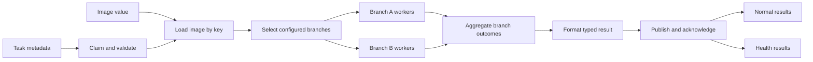

<!-- SPDX-License-Identifier: Apache-2.0 -->

# Task workflow

The operational path reads task metadata and an image value from Redis, runs the configured operator branches, aggregates their outcomes and publishes a typed terminal result.

One branch is the default. A task can target selected branches or all configured branches. Processing starts after submission and continues independently of result retrieval. Every selected branch produces a success or failure outcome, allowing aggregation to finish even when a branch fails.

## Responsibilities

| Responsibility | Implementation | Behavior |
| --- | --- | --- |
| Task intake | TaskService and RedisTransport | Claim metadata, validate the envelope, fetch the separate image value and preserve task correlation. |
| Branch assembly | InspectionWorkflow and Pipeline | Build configured processing paths with independent worker counts and bounded queues. |
| Operator execution | CVOProcessor and OperatorRegistry | Validate explicitly registered operators and parameters; run enabled calls in order inside workers. |
| Target selection | BranchConfig and task targets | Broadcast to all branches or select named branches. |
| Result contracts | Finding, BranchOutcome and ResultMessage | Carry plugin findings, geometry, measurements, image data, source-image keys and structured errors. |
| Aggregation | InspectionWorkflow._aggregate | Collect every selected branch outcome and merge findings in configuration order. |
| Publication | TaskService._complete and RedisTransport.publish | Format one terminal result, publish to normal or health output, then acknowledge the claim. |
| Lifecycle | ServiceController and HTTP controls | Start workers, stop intake, drain accepted work and expose failures. |
| Configuration | Concrete schemas and controller.configure | Validate registered parameter models, apply while stopped and rebuild workers for a new revision. |
| Health tasks | TaskMessage kind=health | Exercise the image-processing path and publish to a dedicated health-result queue. |

## Processing boundaries

Plugins implement detection algorithms. The default chain only handles metadata and preserves image bytes; an empty finding list does not constitute a quality verdict. Plugin-private intermediate data stays inside the plugin. The framework does not load model weights, templates or engineering layers.

Aggregation uses explicit selected branch identities. Failed branches remain visible in the summary. Missing images, invalid targets, operator failures and processing deadlines produce structured failure results. Bounded queues apply backpressure, and shutdown has a finite drain budget.

## Transport contract

Tasks, image values, processing claims and rejected messages use the input database. Normal and health results can use another database on the same server. Database numbers, queue keys and connection parameters are configuration, rather than task-specific routing rules.

Same-database publication and acknowledgement are atomic. Cross-database publication precedes acknowledgement and can produce duplicates after interruption. One service owns each processing list; recovery runs only after that owner stops. Consumers and side-effecting operators must tolerate replay.

See the [operational guide](redis-workflow.md), [architecture diagrams](architecture.md), [capability checklist](capabilities.md) and [verification record](verification.md).
